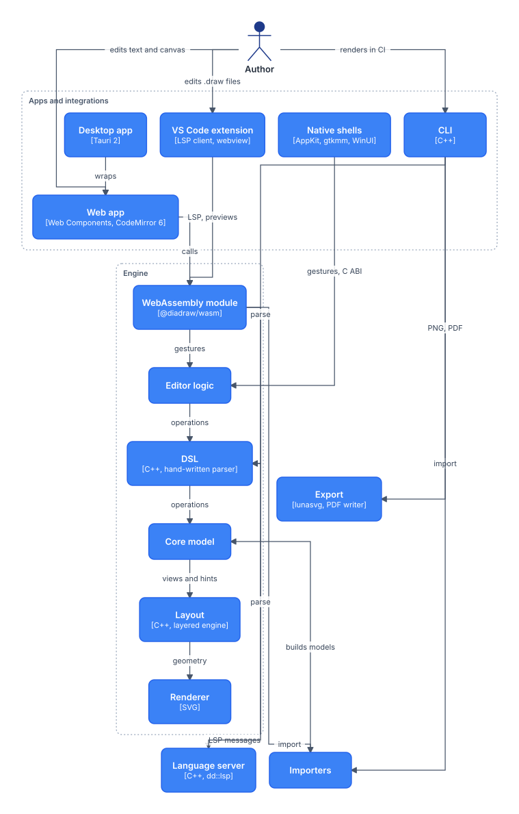

# Architecture



The picture above is [`architecture.draw`](architecture.draw) rendered by the CLI
(`npm run docs:diagrams`), so DiaDraw documents its own architecture.

DiaDraw is one C++ core (`src/`, `libdiadraw`) built around a single document model, with thin
hosts around it: native shells call it directly, and JavaScript hosts (the web app, the VS Code
extension, the Tauri desktop app) load it as one WebAssembly module (`@diadraw/wasm`). The text
DSL and the canvas editor are two views of that model. Layout and rendering read from the model;
nothing reads from an editor.

```
 src/apps/web, src/apps/vscode, src/apps/desktop         src/apps/macos, src/apps/gtk, src/apps/winui, diadraw CLI
   (JavaScript, @diadraw/wasm)                  (native, C++ / C ABI)
            │                                   │
   ┌────────┴────────┐                 ┌────────┴────────┐
   │   text pane     │                 │   canvas pane   │
   │   (dd::dsl)     │                 │  (dd::editor)   │
   └────────┬────────┘                 └────────┬────────┘
            │       typed operations            │
            └──────────────┐   ┌────────────────┘
                           ▼   ▼
                 ┌───────────────────────┐
                 │  model + operation log │   dd::model
                 │  (undo/redo)           │
                 └───────────┬───────────┘
                             │ resolve_view(model, view)
                             ▼
                 ┌───────────────────────┐
                 │  layout                │   dd::layout
                 │  layout(view, hints)   │   (in-house layered engine)
                 └───────────┬───────────┘
                             │ geometry
                             ▼
                 ┌───────────────────────┐
                 │  renderer              │   dd::render
                 │  SVG, display list     │
                 └───────────────────────┘
```

## Model and views (`dd::model`)

The model follows Structurizr: things are defined once, and each diagram is a view of them.

- **Elements** have a stable id, a kind (`person`, `system`, `container`, `process`, `decision`,
  … open-ended for plugins), a display name, an optional parent element, optional group, ports,
  tags and free-form properties. Nested elements (containers in a system) use `parent`.
- **Relationships** connect two endpoints. An endpoint is an element id plus an optional port.
- **Groups** are visual boundaries that are not elements themselves.
- **Ports** are named connection points on an element, with an optional side.
- **Views** pick elements (`include` / `exclude` selectors, optionally scoped to one element's
  children), and carry layout options (algorithm, direction, spacing) and **layout hints**:
  `pin a below b`, `pin a at x, y`, `align …`, `order …`.

The model holds **no geometry**. Positions are always computed by layout, steered by hints. This
keeps the text readable and lets diagrams survive later edits.

Model values are immutable: collections share their items between snapshots, so a model is cheap
to copy and compare. Across the WebAssembly boundary they travel as JSON, in the shapes
`src/wasm/src/types.ts` describes.

## Typed operations and undo

Every change, whether from the text pane or the canvas, is a typed `Operation`:

| Operation            | Inverse                                                                              |
| -------------------- | ------------------------------------------------------------------------------------ |
| `addElement`         | `removeElement`                                                                      |
| `removeElement`      | `batch` re-adding the element, its descendants, and every relationship touching them |
| `renameElement`      | `renameElement` with the old name                                                    |
| `addRelationship`    | `removeRelationship`                                                                 |
| `removeRelationship` | `addRelationship`                                                                    |
| `batch`              | `batch` of the inverses in reverse order (applied atomically)                        |

`apply_operation(model, op)` validates the operation (ids exist, no duplicates, ports exist) and
returns the new model plus the inverse. `History` keeps the done/undone stacks. The same
operations will later carry real-time collaboration.

View hints that reference a removed element are left in place; layout reports them as unmet.

`resolve_view` picks what a view shows. When a view hides a relationship's endpoint but shows one
of its ancestors, the relationship is drawn between the visible ancestors (an implied
relationship, as in C4).

## Text layer (`dd::dsl`)

A hand-written, error-tolerant parser (the grammar is specified in
[`diadraw.grammar`](diadraw.grammar), see [dsl.md](dsl.md)) builds a lossless syntax tree that
keeps comments and whitespace. `parse` lowers it into operations on the model and keeps a source
map (spans of every element, relationship, view and hint). Canvas operations are turned back into
minimal text patches using that map, so a user's formatting is never rewritten. `print` writes
canonical text for new files and importers. `highlight` gives every editor the same colouring.

Geometric canvas edits become **hints**, not coordinates: dragging a node writes `pin a below b`.
Absolute positions (`pin a at x, y`) are an explicit opt-in for freeform diagrams.

## Layout (`dd::layout`)

`resolve_view` turns a view into the visible elements and relationships, and `to_layout_graph`
into an engine-neutral graph (nodes with sizes, parents and ports; edges with optional ports and
label sizes). The layout returns `Geometry`: absolute boxes per node, routed points per edge, and
the hints it could not honour (`ignored_hints`). Groups and visible parents become compound
nodes; the renderer supplies a `Measure` that matches its theme.

`layered` views use DiaDraw's own layered engine (`src/layout/src/layered.cpp`, see
[src/README.md](../src/README.md)); `fixed` views place nodes where `pin … at` puts them, and
`sequence` views lay out lifelines and messages. A **constraint pass** then applies hints the
engine could not (`pin … at`, `align`, pins across layers), pushes overlapped nodes aside, refits
containers and reroutes the touched edges with the orthogonal router. Given the **previous
layout**, the engine keeps the diagram steady across edits.

The engine replaced ELK, which the earlier TypeScript implementation used; the comparison is in
[src/layout/bench/c4-vs-elk.md](../src/layout/bench/c4-vs-elk.md), and older layout benchmarks in
[benchmarks.md](benchmarks.md).

## Renderer (`dd::render`)

`render_svg(view, geometry, options)` produces a standalone SVG string: group and container
boundaries first, then edges with arrow markers and labels, then nodes (shape picked from `shape`
or `kind`: person, cylinder, diamond, stadium, note, rounded box). Elements tagged `external` are
greyed. `create_measure(theme)` sizes nodes and labels to match. Native shells paint the same
scene as a display list (`render/display_list.hpp`); the CLI, the web app and VS Code use the SVG.

## Editing and round-trip (`dd::editor`)

```
canvas gesture ──► Operation ──► update_source(text, op) ──► text edits ──► editor transaction
                                         │                                       │
                                  verified by re-parse                    one undo history
                                                                                 ▼
                                    model ◄── parse(text) ◄──────────── document changed
```

The editor module of the C++ core (`src/editor/src`) turns gestures into operations:
`hint_for_drop` (align or pin from a drop position), `place_operation` (replace the hints that
placed a node), `connect_operation`, `create_operation`, `delete_operation`. `update_source`
(`dd::dsl`) applies the operation to the text as a minimal patch, keeping comments and
formatting, and falls back to a reprint only when a patch cannot express the change (see
[decisions.md](decisions.md)).

`dd::editor::Session` holds a document's text, its parse and the last layout of each view, and
tells a listener about every change: the text set by the host, or patched by an operation or a
gesture. Hosts drive their panes from those events, so the text and the canvas follow each other
whichever one the person used.

The web canvas (`src/apps/web/src/canvas.ts`, and `dd::canvas::Canvas` in the native apps) draws
the rendered scene with an overlay for selection, drag ghosts and the connect handle. Selecting an element moves the text cursor to
its declaration.

## JavaScript hosts (`@diadraw/wasm`)

The whole core is one WebAssembly module. Its API has two kinds of calls:

- **One-shot functions** for pure work: `parse`, `print`, `updateSource`, `highlight`,
  `renderSvg`, `importDiagram`, `exportDrawio`, `exportBpmn`, `palette`, `buildLibrary`, …
- **Long-lived objects that report events**: a `Session` (from `createSession`) takes the text
  and gestures and emits `change` (the new state, and the text update a gesture made) and
  `libraries`; a `LanguageServer` (from `createLanguageServer`) takes client messages with
  `send` and emits `message` for every reply and diagnostic notice. Listeners subscribe with
  `on(type, listener)`.

`setFileSystem` hands the core the host's file system (`@diadraw/wasm/node` supplies Node's), so
sessions and the language server resolve libraries on disk exactly like the native CLI
(`dd::library::DiskLibraries`). In the browser there is no file system: documents use the
built-in libraries and the ones the app loads with `addLibrary`.

## Integrations

- **Importers** (`dd::io`): Mermaid flowcharts, PlantUML (structural, sequence, activity, C4 and
  more), Structurizr DSL and JSON workspaces, draw.io files (`.drawio`, `.xml`, `.drawio.svg`,
  `.drawio.png`; pages keep their geometry as fixed-layout views) and BPMN become models through
  the same operations, then `print` turns them into `.draw` text. Each import returns a report of
  what was not carried over (with line numbers where the source has them); nothing is dropped
  silently. `tools/import-coverage.mjs` summarises those reports over a corpus.
- **Export** (`src/export/include/diadraw/export`): PNG through lunasvg and a vector PDF writer, from
  the same SVG, used by the native CLI and apps. The web app exports PNG with a canvas.
  `export_drawio` and `export_bpmn` write views as draw.io pages or BPMN diagrams, giving
  imported cells their original styles and data back.
- **Language server** (`dd::lsp::Server`): diagnostics, outline, go to definition, hover and
  completion, built on the same parser and source map. It has no transport of its own: `diadraw
lsp` frames it over stdio, and the VS Code extension runs it inside the WebAssembly module.
- **VS Code** (`src/apps/vscode`): TextMate grammar (also inside Markdown fences), the core's
  language server, a live preview beside the editor with a view picker, and SVG export.

## Apps and CLI

- `src/apps/web`: the web app, Web Components on the C++ core compiled to WebAssembly
  (`@diadraw/wasm`). CodeMirror 6 with the grammar (highlighting, live diagnostics) beside an
  editable canvas: select, drag to place, connect, rename, delete, add, with undo/redo across
  both panes. Also a view picker, the corpus as examples, import, the shape palette, share links
  (the document in the URL hash) and SVG, PNG, draw.io and BPMN export.
- `src/apps/macos`, `src/apps/gtk`, `src/apps/winui`: native apps on the C++ core (see `src/README.md`).
- `src/apps/desktop`: Tauri 2 wrapper of the web UI with native open/save dialogs and a file watcher
  (the web app reloads the file when it changes on disk and has no unsaved edits).
- The native `diadraw` binary (`src/apps/cli/src`): `render file.draw [-o out.svg|png|pdf] [--view NAME]`,
  `check file.draw`, `format file.draw [--write]`, `import file [-o out.draw]`, `lib`, `lsp`.

## Dependency rules

- The core modules under `src/` do no I/O and use no platform headers; hosts
  pass files, clocks and libraries in (`dd::library::FileSystem`, shape providers, listeners).
- `layout`, `render` and `dsl` depend on `model`; `editor` and `lsp` sit on top of them.
- Apps and the CLI sit on top of the core; JavaScript only adds glue (`@diadraw/wasm`, the
  apps' UI code), never engine logic.
